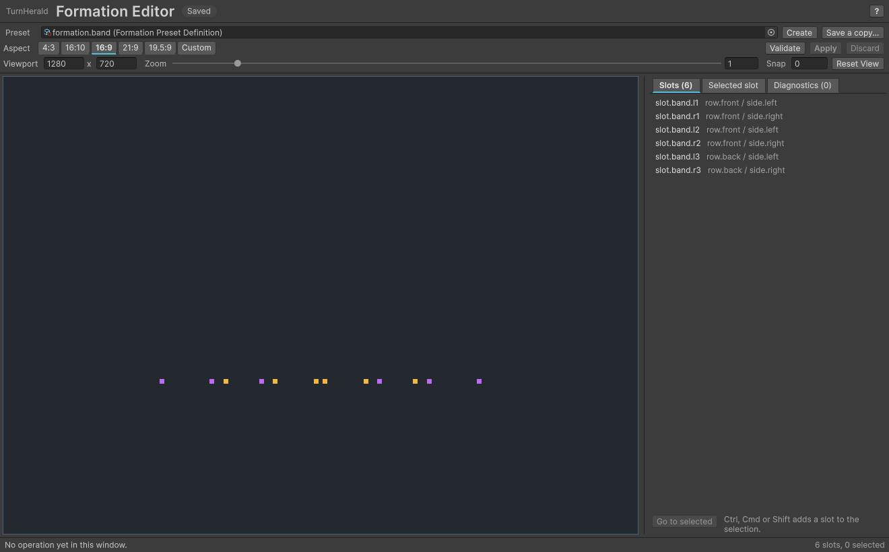
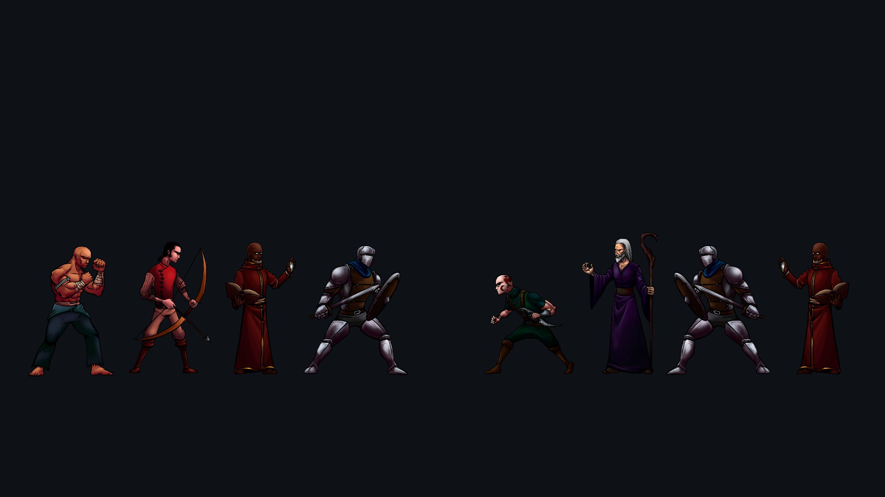
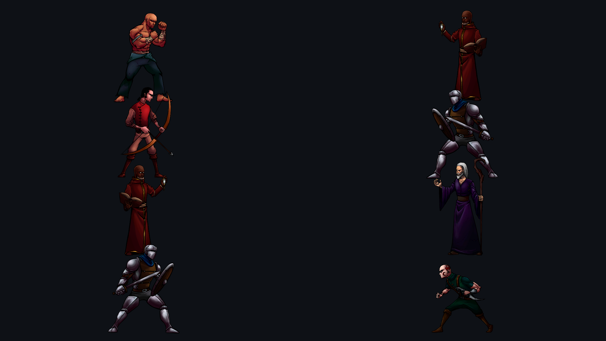
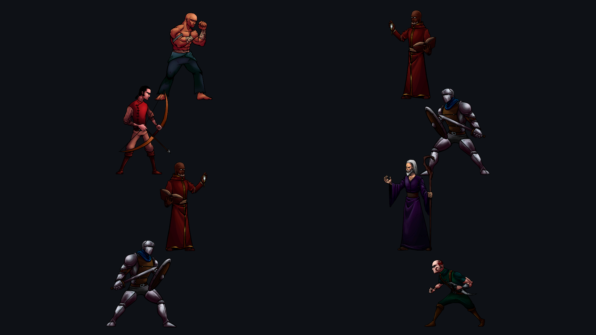
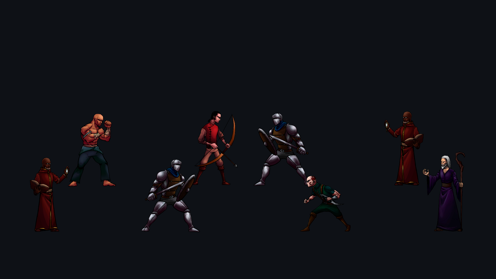

# Place combatants with the Formation Editor

A formation preset holds the slots combatants stand in. You drag those slots against a chosen
aspect ratio, and each slot carries the facing, sorting and effect anchors that presentation
reads back when it draws a token.

---

## Slots are authored in normalized space

Every coordinate on a **Formation Preset** is an integer from **0 to 1,000,000**, with X
increasing to the right and Y increasing upwards from the bottom-left corner. Nothing is
authored in pixels or world units, so one preset serves every resolution. A coordinate outside
that range is a compile error, not a clamp.

Each slot owns three kinds of point:

| Handle | Colour in the preview | What it is |
| --- | --- | --- |
| Slot | Blue | Where the combatant stands |
| Approach | Amber | A second point on the same slot that cues can resolve to |
| VFX anchor | Violet | A named point an effect attaches to, such as a head or a chest |

The preset also carries a **design aspect** - 16:9 unless you change it - and that is the ratio
the runtime fits into your stage. See [How slots reach the screen](#how-slots-reach-the-screen).

## Open the editor

Create a preset from **Assets > Create > TurnHerald > Formation Preset**, then open
**Tools > TurnHerald > Formation Editor** and assign it in the toolbar field. The toolbar's
**Create** and **Duplicate** buttons do the same from inside the window, and **Validate**
recompiles the preset and reports how many diagnostics came back.

{ .shot }

/// caption
The **Slots** list names every slot and the row and side it belongs to. Above it, the aspect
buttons and the viewport fields decide what the preview is measured against.
///

| Control | What it does |
| --- | --- |
| Aspect buttons | Preview the layout at 4:3, 16:10, 16:9, 21:9, 19.5:9, or a custom ratio |
| **Viewport** | The pixel rectangle the normalized points are projected into |
| **Zoom** | Magnifies the preview between 0.1x and 8x; the scroll wheel does the same |
| **Snap** | Grid step in normalized units for a drag; `0` drags freely |
| **Reset View** | Returns pan and zoom to their defaults |

Hold the middle mouse button and drag to pan the preview.

!!! warning "Duplicate keeps the stable ID"
    A duplicated preset intentionally keeps the source's stable ID until you press
    **Regenerate Stable ID** on it. Two assets sharing one ID will not compile.

## Edit a slot

Click a handle in the preview, or a row in the **Slots** list, to select it. Hold ctrl, cmd or
shift to add to or remove from the selection. Dragging then moves everything selected by the
same delta, and the whole drag commits as **one** undo step. Press ++esc++ mid-drag and the
serialized values and the asset's dirty state are both restored.

A drag is clamped so no selected point can leave the legal range: if one handle hits the edge,
the whole selection stops there rather than drifting apart.

The **Selected Slot** panel edits what the slot *is*:

| Field | Effect |
| --- | --- |
| **Slot ID** | The identity an encounter assigns a combatant to |
| **Row ID** | Groups slots into a row for your own layout conventions |
| **Side ID** | Which side of the field this slot belongs to |
| **Facing** | `Left` or `Right`; the direction the token should face. The sprite is mirrored only when this differs from its source-art direction |
| **Sorting Layer Key** | Carried through to the token placement for your own adapters |
| **Sorting Order** | Applied to the token's sprite renderer, so it draws in front or behind |
| **VFX Anchors** | Named anchors, with their coordinates, that effects attach to |

All five ID fields must be valid stable IDs: 1 to 128 characters of lowercase ASCII letters,
digits, `.`, `_` or `-`. None of them may be left empty.

!!! note "Positions are dragged, not typed"
    The panel deliberately omits the slot and approach coordinates - drag them in the preview,
    or type them on the asset's Inspector. Anchor coordinates do appear, inside the
    **VFX Anchors** list. Adding or removing slots, and changing the design aspect, also happen
    on the Inspector; the window edits the slots that already exist.

The authored caps are: 4,096 slots per preset, 16 VFX anchors per slot, sorting order between
-32,768 and 32,767, and aspect components between 1 and 10,000.

## Check occupancy and diagnostics

Assign an **Encounter** in the second toolbar row and tick **Occupancy**. Each slot that the
encounter fills is then labelled in the preview with the combatant instance ID standing in it,
which is how you see an empty back row or a doubled-up slot before you run anything.

Occupancy compiles the encounter's formation, so it holds you to the same rules the compiler
does:

- Exactly two teams, each with both a team and a formation reference.
- Every team member assigned to a slot, and no slot assigned twice.
- All of one team's occupied slots share a single **Side ID**, and the two teams resolve to
  different sides.

Failures appear in the **Diagnostics** list under the slot panel. Clicking one selects the slot
it belongs to and pings the offending asset in the Project window. Two slots sitting on exactly
the same position is reported as a warning rather than an error, since overlapping slots are
sometimes deliberate.

## How slots reach the screen

`BattleStage2D` projects each team's preset with **that preset's own design aspect**, fitted
inside the viewport it was given and centred there; any leftover width or height stays empty.
The aspect buttons in the editor change the preview only - they never change what ships.

The projected seat is the *input* of the next step, not always the place a combatant ends up.
For every occupancy the stage spawns one token, then a **layout** decides where it stands, how
big it is drawn and in what order it is drawn. What you authored per slot stays attached to the
combatant: the compiled **Facing** is recorded on the token, a sprite is mirrored only when its
source-art direction differs from that slot-facing direction, and **Sorting Layer Key** is carried
on the placement for your own code to read. The approach point and the VFX anchors of a slot keep
their authored offset from the slot and move with the feet, so an effect still lands on the
combatant wherever the layout stood it.

Transforms are outputs here, not inputs. Moving a token in the scene changes nothing
authoritative and is overwritten the next time the stage lays out - which is also why a token
in the wrong place is a formation problem, not a scene problem.

To change where the stage itself sits, add **TurnHerald > Battle Stage Frame** next to your
presenter; see [Fit the battle to your screen](interface-layout.md).

## How seats become standing points

The layout is chosen by the theme, through `BattleTheme.FormationLayout` (a
[`FormationLayoutMode`](../reference/formations.md#formationlayoutmode)). It is **presentation
data**. No code in the simulation assemblies refers to a layout, and the solver reads only the
projected seats and the measured art and returns pixels. The layout therefore does not enter the
simulation, a battle hash or a replay, and it never rewrites the seat ids, row ids, side ids or
slot names of a preset. Switching layouts in the middle of a battle moves the tokens and touches no
combat state.

| Mode | What it does |
| --- | --- |
| **Line** (the default) | Every combatant stands on one ground line at full scale, side by side. The authored X of a seat only decides the order; the stage chooses the spacing, the size and the ground line. |
| **Depth** | Two shallow rows per side, the back row shifted half a step, with sizes that shrink toward the horizon of the stage. It needs a stage that declares a floor with a horizon (see below), and falls back to Line when it cannot be used. |
| **Legacy** | The authored seat positions are projected as written, and the skin's rank scale and darkening apply. It keeps content authored before the line layout working. No shipped sample or demo uses it. |

### Which side, and which order

The layout does not read the side id of a seat. It sorts each **team** by where its seats were
authored: a team whose mean seat lies left of the middle of the stage stands on the left, and one
on the right stands on the right. Within a side the seat whose authored X is nearest the middle is
the front (rank 0), and the others follow outward; a tie is broken by the lower authored Y, then by
slot id. The two sides mirror each other.

### Line

Sizes are fractions of the **screen** height, chosen by the number of combatants on the larger
side. The window is the range the stage may use; the aim is where it starts.

| Combatants on the larger side | Sprite height window | Aimed at |
| --- | --- | --- |
| 1 | 36% - 38% | 37% |
| 2 | 33% - 37% | 35% |
| 3 | 32% - 36% | 34% |
| 4 | 26% - 28% | 27% |
| 5 | 22% - 24% | 23% |
| 6 | 20% - 24% | 22.6% |
| 7 | 19% - 22% | 20.5% |
| 8 or more | 17% - 20% | 18.5% |

Once the art has been measured, half of the size difference between illustrations survives, so a
taller figure stays a little taller, and the window caps it. The rest of the rules:

- **Ground line.** The feet stand on the ground line the stage declares
  ([Declare the floor of a stage](declare-a-stage-floor.md)). A stage that declares none gets the
  feet 1.5% of the screen height above the bottom of the stage viewport.
- **Overlap.** Neighbouring silhouettes overlap by 20% of the narrower one (21% with six or more
  on a side). The stage may pack them up to 25% when a side does not fit, and never less than 15%.
  The face of a combatant is kept clear of the body of the neighbour that draws over it.
- **Draw order.** The authored sorting orders are handed out again by rank: the outermost seat of
  a side takes the highest value, so the rear of a side draws over the front.
- **Boss.** A lone combatant facing three or more is drawn 1.5 times larger (at most 46% of the
  screen height) and stands 16% of the viewport width from the middle.
- **Darkening.** The skin's rank scale is not applied, and the darkening behind the front is held
  to at most 8% per rank.

The spacing is computed from the art the tokens wear: the height from the ground anchor to the head
line, and the width of the painted body. Art that was not measured is laid out with a default body
proportion until it is. Whenever art, a ground anchor or a body width changes, the stage lays out
again by itself.

### Depth

Depth stands each side in two shallow rows. Consecutive combatants alternate between the front row,
on the ground line, and a back row above it; the back row sits half a step to the side and leans
toward the vanishing point. A combatant's height falls in proportion to its distance below the
horizon, so the back row is drawn smaller.

Depth is used only when all of these hold:

- the stage declares a floor, a ground line, and both a horizon and a vanishing point;
- the horizon is above the ground line;
- every combatant's art is at most 15% of the screen height at full size.

When one fails, the stage uses Line instead. `BattleStage2D.LayoutResult.Fallback` says which:
`DepthNeedsPerspective` or `DepthSpriteTooLarge`, and `RequestedMode` still reports what you asked
for.

### Legacy

Legacy keeps the authored positions and sorting orders exactly as written and applies the skin's
rank scale and darkening. A theme that asks for Line while the profile turns on the side
information banks (`UseSideInformationBanks`) is run as Legacy by `BattleRuntimeController`,
because the banks order their rows by height.

### Change the layout

In Combat Studio, open **Tools > TurnHerald > Combat Studio > Open**, then the **Appearance** tab and
its **Stage** sub-tab, and pick **Formation layout**. The same value is the `FormationLayout` field
of the theme, so it travels with the profile.

From code, [`BattlePresenter.SetStageLayout(mode, floor)`](../reference/stage-and-tokens.md#battlepresenter)
and [`BattleStage2D.SetLayout(mode, floor)`](../reference/stage-and-tokens.md#battlestage2d) change
the layout at any time without respawning combatants. `floor` is an optional
[`IStageFloorSource`](../reference/formations.md#istagefloorsource); `null` declares no floor.
`BattleStage2D.RelayoutTokens()` lays out again after a change the stage cannot see, such as art
swapped behind its back.

A theme sets the layout through `BattleRuntimeController`, which calls `SetStageLayout` whenever it
applies a theme, so a layout you set by hand on a presenter that this controller drives lasts only
until the next theme is applied.

Sprite heights are fractions of the screen, and the stage only knows its own viewport.
`BattlePresenter.StageShareOfScreenPermille` tells it how much of the screen height the viewport
covers (520, which is 52%, by default); **Battle Stage Frame** sets it for you.

The numbers on this page come from the solver in the package; the full types are in the
[formation reference](../reference/formations.md#formationstagelayout) and the
[stage reference](../reference/stage-and-tokens.md#battlestage2d).

## Start from a disposition

You do not have to place every seat by hand. `FormationArrangements.Build` produces a preset for
one of four stage shapes at any count from one to eight a side, which you then ship as-is or open
in the editor and adjust.

!!! note "These shapes are authored seats"
    The four pictures below show the seats as authored. With the default **Line** layout the stage
    keeps only the *order* of the seats on each side and stands everyone on one ground line, so
    Column, Stagger and Perspective are not reproduced on screen; **Legacy** projects them as written.
    See [How seats become standing points](#how-seats-become-standing-points).


```csharp
var preset = FormationArrangements.Build(
    "formation.myparty", FormationArrangement.Rank, 4);
```

### Rank

The horizontal line-up of Darkest Dungeon, Across the Obelisk and LISA. Both parties share one
ground line and face each other.



### Column

The vertical party list of a classic console role-playing game.



### Stagger

A column with every second seat pushed toward the centre, so a wide silhouette still shows an
edge past the one in front of it.



### Perspective

Two parallel rows a side, the back one raised and inset, for sides too crowded for one readable
column.



### The draw order is not the same in all four

This is the part worth understanding before you author your own. It describes the **Legacy**
layout, which keeps your authored sorting orders. **Line** and **Depth** hand the authored values
out again by rank, with the rear of a side drawing over the front.

**Rank has no depth to read.** Every seat shares a ground line, so the overlap is settled by
convention instead, and the convention is that the *rear* of the party draws over the front.
That is the opposite of what depth would suggest, and it is deliberate: ordering it the other
way buries the back of the party behind the front rank, and the last team member is the one that
stops being readable.

**The other three have real depth**, running up the screen, so the nearer seat wins. Formation
space puts Y at the bottom of the stage, which means a seat lower on screen is nearer the camera
and must be drawn over the ones behind it. Perspective composes both rules: depth between its
rows, the rank convention within a row.

Getting this backwards costs nothing while combatants are small non-overlapping glyphs, and
becomes obvious the moment real character art overlaps. `FormationDepthOrderTests` checks every
pair of seats on a side, across all four arrangements at all eight counts, and across every
shipped preset.

## Next

- **[Combatants, teams and encounters](author-combatants-and-encounters.md)** - assign
  combatants to the slots you just placed.
- **[Declare the floor of a stage](declare-a-stage-floor.md)** - tell the layout where the ground
  line and the props of your plate are.
- **[Fit the battle to your screen](interface-layout.md)** - the stage rectangle the formation
  is projected into.
- **[Turn events into visuals](presentation-recipes.md)** - what the anchors are for.
